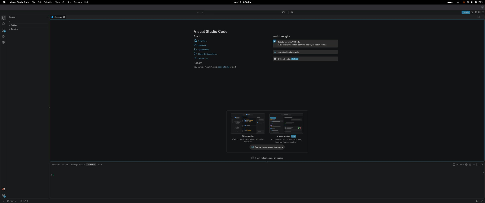

<div align="center">

# 🍎 Mac Topbar

**A macOS-style top bar for GNOME Shell: Fedora logo menu, active app name and a global menu.**


```
[ Fedora logo ▾ ]  [ Active App ]  [ File  Edit  View … ]      Nov 12 11:05      [ Activities ]  (status)
```


</div>

---

<p align="center">
  
</p>

## ✨ Features

- **Fedora logo menu**: the official Fedora mark in monochrome, styled like the Apple menu:
  About This Computer, System Settings, Software, Force Quit, Sleep, Restart, Shut Down,
  Lock Screen, and Log Out.
  - Restart, Shut Down, and Log Out show GNOME's normal confirmation dialog first.
  - Force Quit opens a dialog that lists the running apps and kills the selected one.
- **Active app name** in bold, with Hide and Quit options. Works with every app.
- **Global menu**: the focused app's menus (File, Edit, View…) appear in the top bar, for apps
  that export their menu over DBusMenu. Other apps just show their name.
- **Frosted glass menus**: every top bar menu (calendar and notifications, Quick Settings, the
  logo menu and global menus) gets a live blurred background with a translucent dark tint, the same
  look as [Glass Dock](https://github.com/santidev21/glass-dock). In the Overview they stay opaque.
- **Activities button** moves to the right side of the panel, before the status icons.
- Spanish and English labels, following the system language.

## 🧩 Global menu: app compatibility

GNOME has no global menu of its own. Each app has to export its menu over
`com.canonical.dbusmenu`. It also has to run on X11/XWayland, because apps register their menu
with an X11 window ID.

| App | Status | What it needs |
|---|---|---|
| VS Code | ✅ Works | `--ozone-platform=x11` plus `"window.titleBarStyle": "native"` |
| Wireshark | ✅ Works | `QT_QPA_PLATFORM=xcb` |
| VLC | ✅ Works | `QT_QPA_PLATFORM=xcb` |
| Kdenlive (Flatpak) | ✅ Works | Flatpak override: X11, no Wayland, `QT_QPA_PLATFORM=xcb` |
| OBS Studio (Flatpak) | ✅ Works | Same as Kdenlive, plus `--talk-name=com.canonical.AppMenu.Registrar` |
| Postman (Flatpak) | ❌ | Does not export a menu (it draws its own) |
| SimulIDE | — | Has no menu bar |
| Firefox | ❌ | Fedora's build does not support a global menu |
| GIMP, DBeaver, Audacity | ❌ | GTK3: needs `appmenu-gtk3-module`, which Fedora does not package |
| GNOME apps (Files, Settings…), Alacritty, Spotify | — | Have no menu bar |

### Enabling it per app (all changes are per-user and reversible)

**VS Code**: in `settings.json`:

```json
"window.titleBarStyle": "native",
"window.menuBarVisibility": "toggle"
```

Then make a user copy of the launcher that runs VS Code on XWayland:

```sh
sed -E 's#^Exec=/usr/share/code/code #Exec=/usr/share/code/code --ozone-platform=x11 #' \
  /usr/share/applications/com.microsoft.VSCode.desktop > ~/.local/share/applications/com.microsoft.VSCode.desktop
```

**Qt apps (RPM)**, for example Wireshark and VLC:

```sh
sed -E 's#^Exec=#Exec=env QT_QPA_PLATFORM=xcb #' \
  /usr/share/applications/vlc.desktop > ~/.local/share/applications/vlc.desktop
```

**Qt apps (Flatpak)**, for example Kdenlive and OBS:

```sh
flatpak override --user --nosocket=wayland --socket=x11 --env=QT_QPA_PLATFORM=xcb org.kde.kdenlive
flatpak override --user --talk-name=com.canonical.AppMenu.Registrar com.obsproject.Studio   # if it lacks it
```

To undo: delete the `.desktop` copy, or run `flatpak override --user --reset <app-id>`.

> Apps must be started **after** the extension is enabled. They look for the menu registrar only
> when they open a window.

## 🛠️ How it works

| File | What it does |
|---|---|
| `extension.js` | Builds the bar and moves the Activities button |
| `logoMenu.js` | The Fedora logo menu |
| `forceQuit.js` | The Force Quit dialog |
| `appTitle.js` | Name of the focused app, with Hide and Quit |
| `registrar.js` | Implements `com.canonical.AppMenu.Registrar`, where apps register their menu (window ID → D-Bus service and object path) |
| `dbusmenu.js` | `com.canonical.dbusmenu` client: reads an app's menu tree and turns it into GNOME `PopupMenu`s, loading menus that apps fill on demand |
| `globalMenu.js` | Tracks the focused window and shows its menus in the panel |
| `menuGlass.js` | Frosted glass behind top bar menus: a blurred clone of the windows, masked to the menu's rounded corners. It only exists while a menu is open |
| `icons/fedora-symbolic.svg` | Monochrome Fedora logo, taken from the `fedora-logos` package |

## 📦 Install

```sh
git clone https://github.com/santidev21/mac-topbar.git ~/Dev/mac-topbar
ln -s ~/Dev/mac-topbar ~/.local/share/gnome-shell/extensions/mac-topbar@santidev21
# On Wayland, log out and back in, then:
gnome-extensions enable mac-topbar@santidev21
```

On Wayland, code changes also need a log out and back in to take effect.

To see errors: `journalctl -f -o cat /usr/bin/gnome-shell | grep -i mac-topbar`

## ⚠️ Limitations

- Submenus open inline, the GNOME way, not as side cascades like on macOS.
- The global menu only works with X11/XWayland windows, because native Wayland windows have no
  X11 window ID.

## 🤝 Pairs well with

[**Glass Dock**](https://github.com/santidev21/glass-dock), a macOS-style frosted glass dock with
magnification, intellihide and notification badges.
